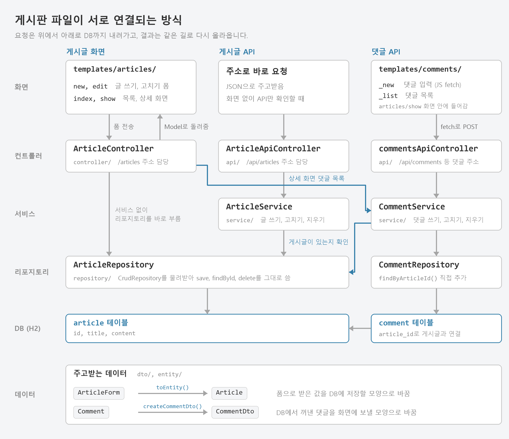

# firstproject

방과후 백엔드 수업에서 교재를 따라 만든 Spring Boot 게시판입니다.
게시글 쓰기, 보기, 고치기, 지우기와 댓글 REST API를 만들고, JUnit 테스트를 작성했습니다.

## 사용한 기술

- Java 17, Spring Boot 4.1.1, Gradle
- Spring Data JPA, H2 (메모리 DB)
- Mustache 템플릿, Lombok

## 실행 방법

```bash
./gradlew bootRun
```

- 게시판: http://localhost:8081/articles
- H2 콘솔: http://localhost:8081/h2-console (JDBC URL `jdbc:h2:mem:testdb`)
- 처음 실행할 때 `data.sql`의 게시글 6개와 댓글 9개가 들어갑니다.

## 파일 구조



회원가입, 인사 페이지 같은 연습용 파일은 그림에서 뺐습니다.

### 글을 쓸 때

`articles/new` 화면에서 폼을 보내면 `ArticleController`가 받습니다.
폼 값(`ArticleForm`)을 `Article` 엔티티로 바꿔 `ArticleRepository`로 저장하고, 저장된 글의 상세 화면으로 보냅니다.

### 댓글을 달 때

상세 화면에 들어 있는 `comments/_new` 템플릿이 자바스크립트 fetch로 댓글 API를 부릅니다.
`CommentService`가 게시글이 있는지 먼저 확인한 뒤 댓글을 저장하고, `CommentDto`로 바꿔 돌려줍니다.

### 폴더

```text
src/main/java/com/example/firstproject
├─ controller/   화면 주소 처리 (ArticleController 등)
├─ api/          REST API (ArticleApiController, commentsApiController)
├─ service/      ArticleService, CommentService
├─ repository/   ArticleRepository, CommentRepository
├─ entity/       Article, Comment
└─ dto/          ArticleForm, CommentDto

src/main/resources
├─ templates/    articles/, comments/, layouts/ (Mustache)
├─ data.sql      처음 넣는 게시글과 댓글
└─ application.properties
```

## 테스트

```bash
./gradlew test
```

13개 모두 통과합니다.

- `ArticleServiceTest` 10개: 게시글 목록, 보기, 쓰기, 고치기, 지우기의 성공과 실패
- `CommentRepositoryTest` 2개: 게시글별 댓글, 닉네임별 댓글 조회
- `FirstprojectApplicationTests` 1개: 앱이 에러 없이 뜨는지 확인
